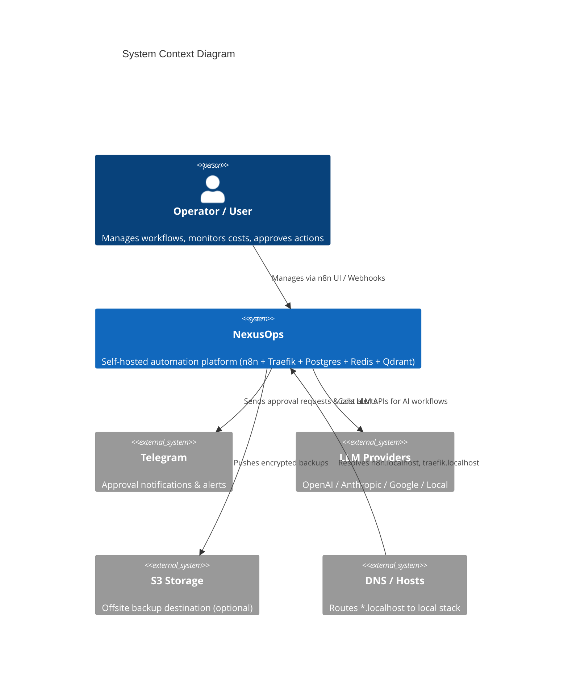
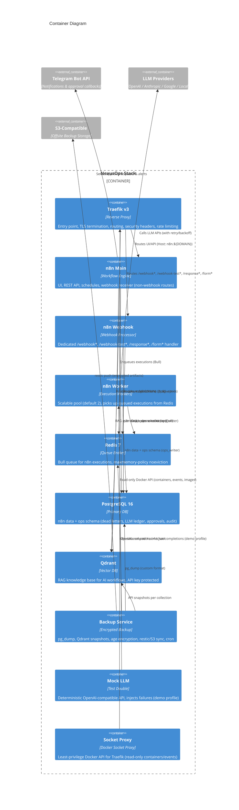
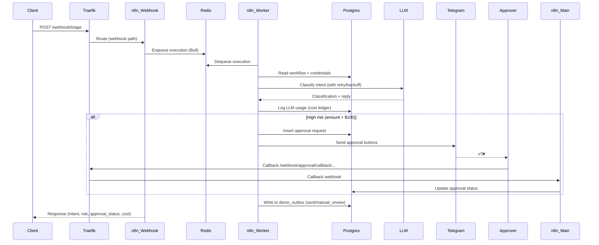
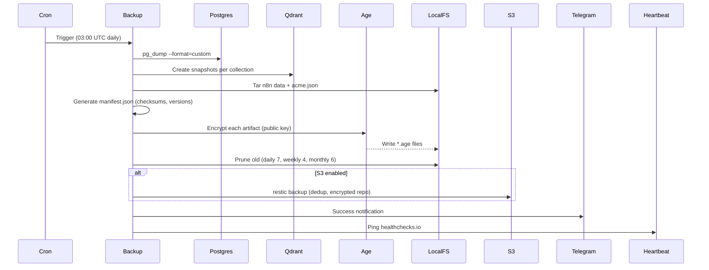
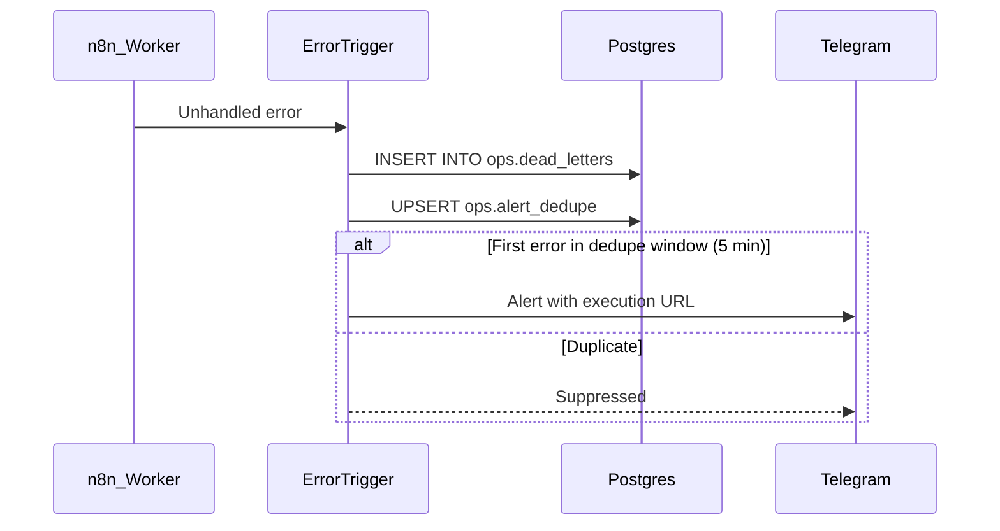

# NexusOps Architecture

## System Context

## Container Diagram

## Network Segmentation

| Network | Purpose | Services | External Access |
|---------|---------|----------|-----------------|
| `edge` | Public ingress | Traefik | Port 80 (HTTP), 443 (HTTPS) |
| `app` | Application layer | Traefik, n8n-main, n8n-webhook, n8n-worker, Mock LLM, Socket Proxy | Internal only |
| `data` | Data layer (internal) | PostgreSQL, Redis, Qdrant, Backup | **Internal only** (`internal: true`) |

**Network Rules:**
- Only `edge` publishes ports to host (80, 443)
- `data` network is `internal: true` — no host access to Postgres, Redis, Qdrant
- Traefik spans `edge` + `app` to route ingress to app services
- n8n services span `app` + `data` to reach queue and database
- Backup only on `data` network (accesses Postgres, Redis, Qdrant volumes)

## Data Flows

### 1. Inbound Webhook → Execution → Response

### 2. Scheduled Backup → Encrypt → Store → Retain

### 3. Error Handling → DLQ → Alert

## Failure Modes & Recovery

| Failure | Detection | Recovery |
|---------|-----------|----------|
| n8n Main down | `make doctor` FAIL, Traefik 502 | `docker compose restart n8n-main` |
| n8n Webhook down | Webhooks return 502 | `docker compose restart n8n-webhook` |
| Worker pool exhausted | Queue depth grows, `make doctor` WARN | `make scale WORKERS=N` |
| Redis OOM | `maxmemory-policy noeviction` prevents silent drop | `make doctor` shows Redis memory; scale workers |
| Postgres connections exhausted | `pg_isready` fails, n8n errors | Increase `max_connections` in compose |
| Qdrant disk full | Healthcheck fails, snapshots fail | Delete old snapshots/collections |
| Backup fails | `make backup` exits non-zero, Telegram alert | Check logs, disk space, S3 creds |
| Certificate expired | Browser warning, `make doctor` FAIL | Delete `acme.json`, restart Traefik |
| n8n encryption key lost | Cannot decrypt credentials | **Restore from backup** (key in n8n data volume) |
| Approval callback fails | Callback returns 4xx/5xx | Check `DLQ_REPLAY_TOKEN`, `N8N_PUBLIC_URL` |

## Component Versions (Pinned)

| Component | Version | Source |
|-----------|---------|--------|
| Traefik | v3.4 | `traefik:v3.4` |
| n8n | stable | `n8nio/n8n:stable` |
| PostgreSQL | 16 | `postgres:16` |
| Redis | 7 | `redis:7` |
| Qdrant | v1.19.2 | `qdrant/qdrant:v1.19.2` |
| Backup (Alpine) | 3.21 | `alpine:3.21` |
| Mock LLM | Python 3.12 | `python:3.12-alpine` |
| Socket Proxy | latest | `tecnativa/docker-socket-proxy:latest` |
| Uptime Kuma | 1.23.16 | `louislam/uptime-kuma:1.23.16` |
| Prometheus | v2.55.1 | `prom/prometheus:v2.55.1` |
| Grafana | 11.1.4 | `grafana/grafana:11.1.4` |

## Security Boundaries

| Boundary | Controls |
|----------|----------|
| Network | `data` network internal; only Traefik publishes ports |
| Container | `no-new-privileges`, `cap_drop: [ALL]`, non-root (UID 1000), read-only rootfs where possible |
| Secrets | `.env` (600), Docker secrets for Postgres/Redis, Age public key only, n8n encryption key in `.env` |
| Traefik | `exposedByDefault=false`, basic auth on dashboard, security headers middleware, TLS 1.2+ |
| Qdrant | API key required, not exposed by default (opt-in via label) |
| Docker Socket | Socket proxy with minimal permissions (CONTAINERS, IMAGES, EVENTS, VERSION only) |

## Next Steps
- [Deployment Guide](deployment.md) — Server sizing, DNS, firewall, first deploy
- [Operations Guide](operations.md) — Day-2 operations, scaling, secret rotation
- [Backup & Restore](backup-restore.md) — RPO/RTO, disaster recovery