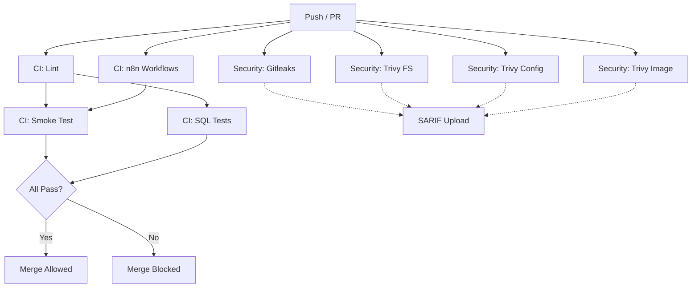

# Contributing & CI Guidelines

## Branch Protection Rules (Recommended)

Configure these branch protection rules for `main` in GitHub repository settings:

### Required Status Checks
The following checks **must pass** before merging:

| Check Name | Workflow | Job |
|------------|----------|-----|
| `Lint` | CI | `lint` |
| `n8n Workflows` | CI | `n8n-workflows` |
| `Smoke Test` | CI | `smoke` |
| `SQL Tests` | CI | `sql-tests` |
| `Gitleaks` | Security | `gitleaks` |
| `Trivy Filesystem` | Security | `trivy-fs` |
| `Trivy Config` | Security | `trivy-config` |
| `Trivy Image` | Security | `trivy-image` |

### Additional Protections
- **Require pull request reviews before merging**: At least 1 approval
- **Dismiss stale PR approvals when new commits are pushed**: Enabled
- **Require review from code owners**: Enabled (see `CODEOWNERS`)
- **Restrict who can dismiss pull request reviews**: Enabled
- **Require linear history**: Enabled (no merge commits)
- **Require status checks to pass before merging**: Enabled (see above)
- **Require branches to be up to date before merging**: Enabled
- **Do not allow bypassing the above settings**: Enabled

### Signing (Optional but Recommended)
- **Require signed commits**: Enabled (if team has GPG keys configured)
- **Require signed tags**: Enabled

## CI Pipeline Overview



### Workflow Details

#### CI (`.github/workflows/ci.yml`)
Runs on: PR to main, push to main

| Job | Timeout | Purpose |
|-----|---------|---------|
| `lint` | 15 min | actionlint, yamllint, shellcheck, hadolint, JSON validation, compose config, markdown links, custom workflow validation |
| `n8n-workflows` | 10 min | Validates workflow JSON structure, no embedded secrets, stable IDs |
| `smoke` | 30 min | Spins up full stack in mock mode, runs health checks, demo webhook test |
| `restore-drill` | 45 min | Runs backup + restore-test (scheduled weekly + on label) |
| `sql-tests` | 15 min | Runs SQL unit tests against live Postgres |

#### Security (`.github/workflows/security.yml`)
Runs on: PR to main, push to main, weekly schedule

| Job | Timeout | Purpose |
|-----|---------|---------|
| `gitleaks` | 15 min | Secret scanning on full history, SARIF upload |
| `trivy-fs` | 20 min | Filesystem vulnerability scan, SARIF upload |
| `trivy-config` | 15 min | Dockerfile/compose config scan, SARIF upload |
| `trivy-image` | 20 min | Custom backup image scan, SARIF upload |
| `dependency-review` | 10 min | Reviews dependency changes in PRs |

#### Release (`.github/workflows/release.yml`)
Runs on: Push to main (triggered by release-please)

| Job | Purpose |
|-----|---------|
| `release-please` | Creates release PR based on Conventional Commits |
| `build-backup-image` | Multi-arch (amd64/arm64) build + push to GHCR with SBOM |
| `publish-release` | Creates release archive with compose files |

## Required Status Checks Configuration

In GitHub Settings → Branches → Branch protection rules → `main`:

```
Required status checks:
☑ Lint
☑ n8n Workflows  
☑ Smoke Test
☑ SQL Tests
☑ Gitleaks
☑ Trivy Filesystem
☑ Trivy Config
☑ Trivy Image
```

## CI Badges for README

Add these to your README.md:

```markdown


```

Replace `YOUR_USERNAME` with your GitHub username/org.

## Concurrency & Caching

- **Concurrency groups**: Cancel superseded runs for same PR/branch
- **Caching**: Node.js modules, Docker Buildx layers, Go modules
- **Timeouts**: All jobs have explicit timeouts (10-45 min)

## Local CI Simulation

Run the same checks locally before pushing:

```bash
# Lint
actionlint
yamllint -c .yamllint .
shellcheck scripts/*.sh infra/**/*.sh
hadolint Dockerfile infra/backup/Dockerfile infra/mock-llm/Dockerfile
./scripts/check-workflows.sh workflows
docker compose -p nexusops -f compose.yaml config -q
docker compose -p nexusops -f compose.yaml -f compose.prod.yaml config -q

# Security
gitleaks detect --source . --verbose
trivy fs --severity CRITICAL,HIGH,MEDIUM .
trivy config --severity CRITICAL,HIGH,MEDIUM .
docker build -t nexusops-backup:local -f infra/backup/Dockerfile infra/backup/
trivy image --severity CRITICAL,HIGH,MEDIUM nexusops-backup:local

# Tests
docker compose -p nexusops-test -f compose.yaml up -d --wait
./scripts/check-workflows.sh workflows
psql -h localhost -U nexusops -d nexusops -f tests/sql/test_llm_cost.sql
docker compose -p nexusops-test -f compose.yaml down -v
```

## Contribution Workflow

1. **Fork** the repository
2. **Create branch** with descriptive name: `feat/short-description`, `fix/issue-123`
3. **Make changes** following Conventional Commits:
   - `feat(scope): add new feature`
   - `fix(scope): resolve issue`
   - `docs(scope): update documentation`
   - `chore(scope): maintenance`
4. **Run local CI** (see above)
5. **Push branch** and open PR
6. **Wait for CI** - all required checks must pass
7. **Address review comments**
8. **Merge** (squash and merge recommended)

## Code Owners

See `CODEOWNERS` file for required reviewers per path.

## Secrets in CI

Never commit secrets. CI uses:
- `GITHUB_TOKEN` for GHCR login
- Generated test secrets for smoke/restore tests
- No external secrets needed for standard CI

For release:
- GHCR push uses `GITHUB_TOKEN` (automatic)
- SBOM attestation uses `id-token: write`