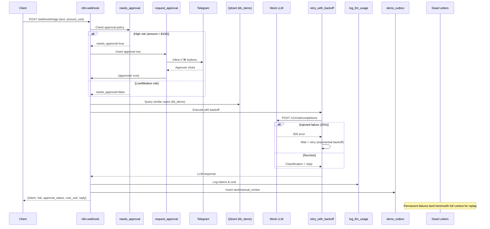

# NexusOps Demo: Smart Inbound Request Triage

## Overview

This demo showcases the NexusOps platform's integrated capabilities in a single 60-second flow:

1. **Error Handling** (Phase 6) — Retry with backoff, DLQ, global error handler
2. **LLM Cost Tracking** (Phase 7) — Usage ledger, budget guard
3. **Human-in-the-Loop** (Phase 8) — Approval flow with escalation

All running in **mock mode** — no API keys required.

## Architecture



## Quick Start

### Prerequisites
- Docker + Docker Compose v2
- (Optional) Telegram bot token for approval notifications

### Run the Demo

```bash
# 1. Clone and configure
git clone <repo> nexusops && cd nexusops
cp .env.example .env
# Edit .env if you want Telegram alerts:
# ALERT_TELEGRAM_BOT_TOKEN=xxx
# ALERT_TELEGRAM_CHAT_ID=xxx
# DEFAULT_APPROVER_PRIMARY=your_chat_id

# 2. Run demo (includes mock LLM, seeds data, sends 5 requests, prints summary)
make demo

# 3. Watch the output - you should see:
# - 5 requests processed
# - Non-zero LLM costs
# - At least 1 approval request (high risk)
# - At least 1 retry sequence (mock failure)
# - At least 1 DLQ item (permanent failure)
```

### What Happens

| Request | Scenario | Expected Outcome |
|---------|----------|------------------|
| 1 | General inquiry (low risk) | Auto-approved, low cost, sent to outbox |
| 2 | Billing inquiry $50 (medium) | Auto-approved, medium cost |
| 3 | Refund $200 (high) | **Approval required** → Telegram buttons |
| 4 | Injected mock failure | **Retry with backoff** → eventually succeeds |
| 5 | Account deletion (high) | **Approval required** + **DLQ if rejected** |

### Sample Output

```
=== Demo Summary ---
--- LLM Usage & Costs ---
 workflow_name | calls | input_tokens | output_tokens | total_cost_usd
 showcase_ai_ops | 5 | 1234 | 567 | 0.004500

--- Approvals ---
 id | action_type | risk_level | status | decided_by
 uuid-1 | spend_money | high | approved | 123456789
 uuid-2 | external_api | high | pending | 

--- Dead Letter Queue ---
 id | workflow_name | node_name | status
 uuid-3 | showcase_ai_ops | LLM Call | pending

--- Demo Outbox ---
 id | correlation_id | action_type | status
 1 | abc123 | triage | sent
 2 | def456 | triage | manual_review
```

## Recording the README GIF (60-Second Script)

### Setup (before recording)
```bash
# Terminal 1: Run demo
make demo

# Terminal 2: Watch n8n executions
watch -n 2 'docker exec nexusops_postgres psql -U nexusops -d nexusops -c "SELECT * FROM ops.v_pending_approvals;"'

# Terminal 3: Watch Telegram (if configured) or approval webhook logs
docker compose logs -f n8n-main | grep -E "(approval|Approved|Rejected)"
```

### Recording Flow (60 seconds)

| Time | Action | What Viewer Sees |
|------|--------|------------------|
| 0-5s | `make demo` starts | Containers starting, health checks passing |
| 5-15s | 5 requests sent rapidly | JSON responses with `correlation_id`, `intent`, `risk_level`, `approval_status` |
| 15-25s | Approval request appears | Telegram notification with ✅/❌ buttons (or webhook log) |
| 25-35s | Click **Approve** | Request 3 status changes to `approved`, reply sent |
| 35-45s | Retry sequence visible | Request 4 shows `LLM Call` node retried 2-3 times |
| 45-55s | DLQ item appears | Request 5 (permanent failure) in `ops.dead_letters` |
| 55-60s | Summary table printed | Costs > 0, approvals, retries, DLQ all visible |

### Key Moments to Highlight

1. **No API keys** — `DEMO_MODE=mock` runs entirely offline
2. **Policy-driven approval** — `amount_usd > 100` triggers human review automatically
3. **Retry with backoff** — Exponential delay + jitter visible in execution timeline
4. **Cost tracking** — Each LLM call logged with token counts and computed USD cost
5. **Audit trail** — Every approval decision logged with actor, timestamp, reason

## Files

| File | Purpose |
|------|---------|
| `workflows/demo/showcase_ai_ops.json` | Main triage workflow |
| `scripts/demo.sh` | Demo runner (seeds, sends requests, prints summary) |
| `scripts/seed-qdrant-demo.sh` | Creates `kb_demo` collection with 10 sample docs |
| `infra/mock-llm/` | Mock LLM service (deterministic, injects failures) |
| `infra/postgres/init/50-ops-demo.sql` | `ops.demo_outbox` table |

## Make Targets

```bash
make demo              # Run full demo (mock mode)
make demo cleanup      # Clean up demo containers
make demo summary      # Print summary from running demo
```

## Environment Variables

| Variable | Default | Description |
|----------|---------|-------------|
| `DEMO_MODE` | `mock` | `mock` or `live` (requires LLM API key) |
| `MOCK_FAILURE_RATE` | `0.3` | Fraction of LLM calls that fail (for retry demo) |

## Extending the Demo

### Live Mode (with real LLM)
```bash
# Set API key and model
export OPENAI_API_KEY=sk-...
export DEMO_MODE=live
make demo
```

### Custom Scenarios
Edit `scripts/demo.sh` to send different request payloads, or call the webhook directly:
```bash
curl -X POST http://localhost/webhook/triage \
  -H "Content-Type: application/json" \
  -d '{"text": "Your custom request", "amount_usd": 500}'
```

## Troubleshooting

| Issue | Resolution |
|-------|------------|
| `make demo` hangs | Check `docker compose ps` — all services should be `healthy` |
| No approval in Telegram | Verify `ALERT_TELEGRAM_BOT_TOKEN`, `ALERT_TELEGRAM_CHAT_ID`, `DEFAULT_APPROVER_PRIMARY` in `.env` |
| Mock LLM not responding | `docker compose logs mock-llm` — should show "Mock LLM server starting on port 8080" |
| Qdrant seeding fails | Ensure `QDRANT_API_KEY` is set in `.env` |
| Summary shows no data | Increase `sleep 10` in `scripts/demo.sh` to allow async processing |

## Cleanup

```bash
make demo cleanup
# Or manually:
docker compose -p nexusops --profile demo down -v
```