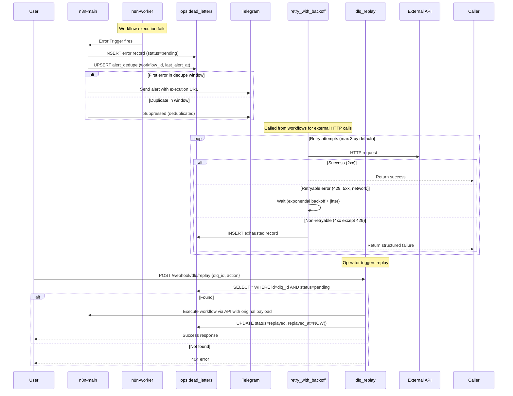

# NexusOps Error Handling & Resilience

## Overview

This document describes the platform-level error handling system implemented as reusable, version-controlled n8n workflows.

## Architecture

### Components

| Component | Type | Purpose |
|-----------|------|---------|
| `ops.dead_letters` | PostgreSQL table | Persistent dead-letter queue with status tracking |
| `ops.alert_dedupe` | PostgreSQL table | Deduplication for Telegram alerts |
| `ops.v_error_summary` | PostgreSQL view | Daily error counts per workflow |
| `global_error_handler` | n8n workflow (Error Trigger) | Catches all unhandled errors, writes to DLQ, sends alert |
| `retry_with_backoff` | n8n workflow (callable) | Retries HTTP calls with exponential backoff + jitter |
| `dlq_replay` | n8n workflow (webhook) | Lists, replays, or discards DLQ items |
| `healthcheck_ping` | n8n workflow (cron) | Periodic heartbeat to external monitoring |
| `n8n-bootstrap` | One-shot service | Imports workflows, creates credentials, sets global error handler |

## Flow Diagram



## Database Schema

### `ops.dead_letters`

| Column | Type | Description |
|--------|------|-------------|
| `id` | BIGSERIAL | Primary key |
| `created_at` | TIMESTAMPTZ | When the error occurred |
| `workflow_id` | TEXT | n8n workflow ID |
| `workflow_name` | TEXT | n8n workflow name |
| `execution_id` | TEXT | n8n execution ID |
| `node_name` | TEXT | Failing node name |
| `error_message` | TEXT | Error message |
| `error_stack` | TEXT | Stack trace (nullable) |
| `payload` | JSONB | Input payload that caused the error |
| `attempts` | INT | Retry attempts made |
| `status` | TEXT | `pending` / `replayed` / `discarded` |
| `replayed_at` | TIMESTAMPTZ | When replayed |
| `notes` | TEXT | Operator notes |

**Indexes:**
- `(status, created_at DESC)` — for listing pending items
- `(workflow_id, execution_id)` — for correlation
- `(created_at DESC)` — for time-based queries

### `ops.alert_dedupe`

| Column | Type | Description |
|--------|------|-------------|
| `workflow_id` | TEXT PK | Workflow identifier |
| `last_alert_at` | TIMESTAMPTZ | Last alert timestamp |
| `alert_count` | INT | Total alerts for this workflow |

### `ops.v_error_summary` (View)

Daily error counts per workflow:
```sql
SELECT workflow_id, workflow_name, DATE(created_at) AS error_date,
       COUNT(*) AS error_count,
       COUNT(*) FILTER (WHERE status = 'pending') AS pending_count,
       ...
FROM ops.dead_letters
GROUP BY workflow_id, workflow_name, DATE(created_at);
```

## Workflows

### 1. Global Error Handler (`global_error_handler.json`)

- **Trigger**: Error Trigger (catches all unhandled errors in the n8n instance)
- **Actions**:
  1. Prepares DLQ record from error context
  2. Inserts into `ops.dead_letters` with `status='pending'`
  3. Checks `ops.alert_dedupe` — if last alert > `ALERT_DEDUPE_WINDOW_MS` (default 5 min), sends Telegram alert
  4. Upserts `ops.alert_dedupe` with current timestamp

**Alert content:**
```
🚨 NexusOps Error Alert

Workflow: My Workflow (abc-123)
Node: HTTP Request
Execution: exec-456 (link)
Error: Connection timeout
Severity: critical
Time: 2026-10-22 03:15:00 UTC
```

### 2. Retry with Backoff (`retry_with_backoff.json`)

**Callable sub-workflow** — invoke via `Execute Workflow` node.

**Inputs:**
```json
{
  "target_url": "https://api.example.com/endpoint",
  "method": "POST",
  "body": { "key": "value" },
  "max_attempts": 3,
  "base_delay_ms": 1000,
  "factor": 2,
  "jitter": 0.1
}
```

**Behavior:**
- Attempts up to `max_attempts` times
- Delay = `base_delay * factor^attempt * (1 ± jitter)`
- **Retryable**: network errors, 408, 429, 500, 502, 503, 504, honors `Retry-After` header
- **Non-retryable**: 4xx (except 429) → immediate DLQ insert
- On exhaustion: writes to `ops.dead_letters` with `attempts=max_attempts`

**Output (success):**
```json
{ "success": true, "data": { ...response... } }
```

**Output (exhausted):**
```json
{ "success": false, "error": "...", "exhausted": true }
```

### 3. DLQ Replay (`dlq_replay.json`)

**Webhook endpoint**: `POST /webhook/dlq/replay`

**Authentication**: Bearer token `DLQ_REPLAY_TOKEN`

**Actions:**

| Action | Payload | Result |
|--------|---------|--------|
| `list` | `{ "action": "list" }` | Returns 50 pending DLQ items |
| `replay` | `{ "action": "replay", "dlq_id": 123 }` | Re-executes original workflow, marks `replayed` |
| `discard` | `{ "action": "discard", "dlq_id": 123, "notes": "..." }` | Marks `discarded` |

### 4. Healthcheck Ping (`healthcheck_ping.json`)

**Schedule**: Every 5 minutes (configurable via cron)

**Action**: GET `HEALTHCHECK_PING_URL` (or `BACKUP_HEARTBEAT_URL`)

## Bootstrap Process

The `n8n-bootstrap` service (one-shot container) runs after `n8n-main` and `n8n-webhook` are healthy.

### Steps

1. **Wait for n8n** — polls `/healthz` until ready
2. **Create credentials** from environment variables:
   - `ops_writer_credentials` (Postgres) ← `OPS_WRITER_PASSWORD`
   - `telegram_credentials` ← `ALERT_TELEGRAM_BOT_TOKEN` + `ALERT_TELEGRAM_CHAT_ID`
3. **Import workflows** from `/workflows` (idempotent by stable workflow ID)
4. **Activate core workflows**: `global-error-handler`, `dlq-replay`
5. **Set global error workflow** via n8n API to `global-error-handler`

**Idempotency**: Re-running bootstrap updates existing workflows/credentials (uses stable IDs in JSON).

## Required Environment Variables

| Variable | Required For | Description |
|----------|--------------|-------------|
| `OPS_WRITER_PASSWORD` | Bootstrap, DLQ | Postgres password for `ops_writer` role |
| `ALERT_TELEGRAM_BOT_TOKEN` | Global handler, Bootstrap | Telegram bot token |
| `ALERT_TELEGRAM_CHAT_ID` | Global handler, Bootstrap | Telegram chat ID |
| `DLQ_REPLAY_TOKEN` | DLQ Replay | Bearer token for replay webhook |
| `N8N_BOOTSTRAP_USER` | Bootstrap | n8n admin user |
| `N8N_BOOTSTRAP_PASSWORD` | Bootstrap | n8n admin password |
| `N8N_PUBLIC_URL` | Global handler | Public base URL for execution links |
| `ALERT_DEDUPE_WINDOW_MS` | Global handler | Dedupe window (ms, default 300000) |
| `HEALTHCHECK_PING_URL` | Healthcheck ping | Heartbeat endpoint |

## Operator Guide

### View Pending DLQ Items

```bash
# Via psql
docker exec -it nexusops_postgres psql -U nexusops -d nexusops -c \
  "SELECT id, created_at, workflow_name, node_name, error_message, attempts, status FROM ops.dead_letters WHERE status='pending' ORDER BY created_at DESC LIMIT 20;"

# Via workflow (requires DLQ_REPLAY_TOKEN)
curl -X POST http://n8n.localhost/webhook/dlq/replay \
  -H "Authorization: Bearer $DLQ_REPLAY_TOKEN" \
  -H "Content-Type: application/json" \
  -d '{"action": "list"}'
```

### Replay a Failed Execution

```bash
curl -X POST http://n8n.localhost/webhook/dlq/replay \
  -H "Authorization: Bearer $DLQ_REPLAY_TOKEN" \
  -H "Content-Type: application/json" \
  -d '{"action": "replay", "dlq_id": 123}'
```

### Discard a DLQ Item

```bash
curl -X POST http://n8n.localhost/webhook/dlq/replay \
  -H "Authorization: Bearer $DLQ_REPLAY_TOKEN" \
  -H "Content-Type: application/json" \
  -d '{"action": "discard", "dlq_id": 123, "notes": "Known issue, won\\'t fix"}'
```

### Monitor Error Summary

```bash
docker exec -it nexusops_postgres psql -U nexusops -d nexusops -c \
  "SELECT * FROM ops.v_error_summary WHERE error_date >= CURRENT_DATE - INTERVAL '7 days';"
```

### Test Retry with Backoff

Import `retry_with_backoff.json` and call it from another workflow using **Execute Workflow** node, or test via webhook:

```bash
# Create a test workflow that calls retry_with_backoff
# The chaos demo workflow (workflows/demo/chaos_api.json) demonstrates this
```

### Verify Deduplication

Trigger the same error twice within 5 minutes — only one Telegram alert should arrive.

## Chaos Demo

`workflows/demo/chaos_api.json` — Webhook at `/webhook/chaos`

**Parameters:**
- `fail_count` (default 3) — how many times to fail before succeeding
- `delay_ms` (default 500) — delay between attempts

**Behavior:**
1. First N calls fail with simulated error (triggers global error handler → DLQ + alert)
2. After N failures, succeeds
3. Each failure increments attempt counter in static data

**Test:**
```bash
# Fail 3 times then succeed
curl -X POST http://n8n.localhost/webhook/chaos \
  -H "Content-Type: application/json" \
  -d '{"fail_count": 3, "delay_ms": 200}'

# Permanent failure (ends in DLQ after retries exhausted)
# Call retry_with_backoff with a non-retryable 400 error
```

## Files

| File | Purpose |
|------|---------|
| `infra/postgres/init/20-ops-errors.sql` | Dead letters schema, view, grants |
| `workflows/core/global_error_handler.json` | Global error trigger workflow |
| `workflows/core/retry_with_backoff.json` | Retry with exponential backoff |
| `workflows/core/dlq_replay.json` | DLQ management webhook |
| `workflows/core/healthcheck_ping.json` | Periodic heartbeat |
| `workflows/demo/chaos_api.json` | Chaos testing workflow |
| `infra/n8n/bootstrap.sh` | Bootstrap script |
| `compose.yaml` | n8n-bootstrap service definition |

## ADR References

- ADR 0004: Dead-letter queue design (to be created)
- ADR 0005: Retry with backoff strategy (to be created)