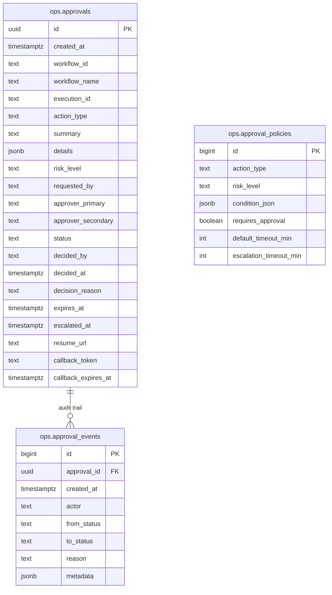
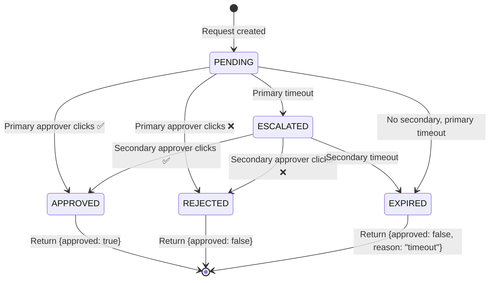

# NexusOps Human-in-the-Loop Approvals

## Overview

This document describes the reusable approval mechanism for sensitive actions in NexusOps workflows. The system provides:
- Configurable approval policies by action type and risk level
- Telegram-based approval with inline buttons
- Automatic escalation to secondary approver on timeout
- Full audit trail of all state transitions
- Secure callback authentication

## Architecture

### Database Schema



### State Machine



## Workflows

### 1. `request_approval` (callable sub-workflow)

**Inputs:**
```json
{
  "action_type": "delete_data",
  "summary": "Delete 500 old log records",
  "details": { "table": "logs", "where": "created_at < '2024-01-01'", "estimated_rows": 500 },
  "risk_level": "medium",
  "timeout_minutes": 60,
  "approver_primary": "123456789",
  "approver_secondary": "987654321",
  "requested_by": "cleanup-workflow",
  "workflow_id": "wf-123",
  "workflow_name": "Daily Cleanup",
  "execution_id": "exec-456"
}
```

**Process:**
1. Generates UUID + secure callback token
2. Inserts into `ops.approvals` with `status='pending'`
3. Sends Telegram to primary approver with inline buttons
4. If secondary configured, also notifies them
5. Waits for callback (or timeout)
6. On callback: validates token, checks authorization, updates status
7. On timeout: escalates to secondary (if configured) or expires
8. Returns `{approved, decided_by, reason, status, approval_id}`

**Returns:**
```json
{
  "approved": true,
  "decided_by": "123456789",
  "reason": "Approved via Telegram",
  "status": "approved",
  "approval_id": "uuid-here"
}
```

### 2. `needs_approval` (helper)

**Inputs:**
```json
{
  "action_type": "delete_data",
  "risk_level": "medium",
  "context": { "rows": 500, "table": "logs" }
}
```

**Returns:**
```json
{
  "needs_approval": true,
  "policy": { "requires_approval": true, "default_timeout_min": 60, "escalation_timeout_min": 30 },
  "timeout_minutes": 60,
  "escalation_timeout_min": 30
}
```

### 3. Policy Configuration (`workflows/approvals/policy.json` + `ops.approval_policies` table)

| Action Type | Risk | Condition | Timeout | Escalation |
|-------------|------|-----------|---------|------------|
| send_bulk_email | low | recipients > 100 | 30 min | 15 min |
| send_bulk_email | medium | recipients > 1000 | 60 min | 30 min |
| send_bulk_email | high | recipients > 10000 | 120 min | 60 min |
| delete_data | low | rows > 10 | 30 min | 15 min |
| delete_data | medium | rows > 100 | 60 min | 30 min |
| delete_data | high | rows > 1000 | 120 min | 60 min |
| spend_money | low | amount > $10 | 30 min | 15 min |
| spend_money | medium | amount > $100 | 60 min | 30 min |
| spend_money | high | amount > $1000 | 120 min | 60 min |
| external_api | medium | writes=true | 30 min | 15 min |
| deploy | high | always | 120 min | 60 min |

## Telegram Message Format

### Initial Request (Primary Approver)

```
🔔 Approval Request

Action: delete_data
Risk: MEDIUM
Summary: Delete 500 old log records
Requested by: cleanup-workflow
Workflow: Daily Cleanup (wf-123)
Execution: exec-456
Expires: 2026-10-22T03:45:00.000Z

Details:
```json
{
  "table": "logs",
  "where": "created_at < '2024-01-01'",
  "estimated_rows": 500
}
```

[✅ Approve] [❌ Reject]
```

### Escalation Notification (Secondary Approver)

```
⚠️ Escalation: Approval Timeout

Primary approver did not respond in time.

Action: delete_data
Summary: Delete 500 old log records
Workflow: Daily Cleanup
Original request: 2026-10-22T03:15:00.000Z

Please review and decide.

[✅ Approve] [❌ Reject]
```

### Decision Confirmation (sent to requester via workflow resume)

The calling workflow receives the decision and continues execution.

## Security

### Callback Authentication

1. **Signed token**: Each approval gets a cryptographically random `callback_token` (32 bytes hex)
2. **Token binding**: Token stored in `ops.approvals.callback_token` with expiry (`callback_expires_at`)
3. **Authorization check**: Only `approver_primary` or `approver_secondary` chat IDs can decide
4. **Single decision**: Status must be `pending` or `escalated`; replay attempts are rejected
5. **Token expiry**: Token invalid after `callback_expires_at` (timeout + 60 min buffer)

### Redaction Policy

Telegram messages **never** include:
- Full database queries
- API keys or secrets
- PII beyond what's in `summary`
- Full execution payloads (truncated to 500 chars in `details`)

Only `summary`, `action_type`, `risk_level`, `workflow_name`, `execution_id`, and truncated `details` are shown.

## Adding a Second Channel (Slack/Email)

To add Slack:

1. Add `slack_webhook_url` or `slack_bot_token` to credentials
2. In `request_approval`, add a parallel branch after "Insert Approval":
   ```json
   {
     "node": "Slack Request",
     "type": "n8n-nodes-base.slack",
     "parameters": {
       "channel": "{{ $json.approver_primary_slack }}",
       "text": "{{ $json.message }}",
       "blocks": [
         { "type": "section", "text": { "type": "mrkdwn", "text": "{{ $json.message }}" }},
         { "type": "actions", "elements": [
           { "type": "button", "text": { "type": "plain_text", "text": "Approve" }, "value": "approve:{{$json.approval_id}}:{{$json.callback_token}}", "style": "primary" },
           { "type": "button", "text": { "type": "plain_text", "text": "Reject" }, "value": "reject:{{$json.approval_id}}:{{$json.callback_token}}", "style": "danger" }
         ]}
       ]
     }
   }
   ```
3. Create a Slack callback webhook endpoint (`/webhook/approval/slack/callback/...`)
4. Reuse the same `Parse Callback` → `Get Approval` → validation → `Update Approval` chain

## Usage in Workflows

### Pattern: Check policy → Request approval → Act on decision

```
[Start] → [Needs Approval] → [If needs_approval]
    │                              │
    │                              ├─▶ [Request Approval] → [If approved]
    │                              │                            │
    │                              │                            ├─▶ [Do sensitive action]
    │                              │                            │
    │                              │                            └─▶ [Notify rejection]
    │                              │
    └─▶ [Do action directly (no approval needed)]
```

### Example: Conditional Delete

```json
{
  "nodes": [
    {
      "name": "Check Approval Need",
      "type": "n8n-nodes-base.executeWorkflow",
      "parameters": {
        "workflowId": "needs_approval",
        "data": {
          "action_type": "delete_data",
          "risk_level": "medium",
          "context": { "rows": 500 }
        }
      }
    },
    {
      "name": "If Needs Approval",
      "type": "n8n-nodes-base.if",
      "parameters": {
        "conditions": { "boolean": [{ "value1": "={{ $json.needs_approval }}", "operation": "true" }] }
      }
    },
    {
      "name": "Request Approval",
      "type": "n8n-nodes-base.executeWorkflow",
      "parameters": {
        "workflowId": "request_approval",
        "data": {
          "action_type": "delete_data",
          "summary": "Delete 500 old log records",
          "details": { "table": "logs", "where": "created_at < '2024-01-01'", "estimated_rows": 500 },
          "risk_level": "medium",
          "timeout_minutes": 60
        }
      }
    },
    {
      "name": "If Approved",
      "type": "n8n-nodes-base.if",
      "parameters": {
        "conditions": { "boolean": [{ "value1": "={{ $json.approved }}", "operation": "true" }] }
      }
    },
    {
      "name": "Execute Delete",
      "type": "n8n-nodes-base.postgres",
      "parameters": {
        "operation": "executeQuery",
        "query": "DELETE FROM logs WHERE created_at < '2024-01-01';"
      }
    }
  ]
}
```

## Audit Queries

### View pending approvals
```sql
SELECT * FROM ops.v_pending_approvals;
```

### Full audit trail for an approval
```sql
SELECT created_at, actor, from_status, to_status, reason, metadata
FROM ops.approval_events
WHERE approval_id = 'uuid-here'
ORDER BY created_at;
```

### Approval statistics
```sql
SELECT
  action_type,
  risk_level,
  COUNT(*) AS total,
  COUNT(*) FILTER (WHERE status = 'approved') AS approved,
  COUNT(*) FILTER (WHERE status = 'rejected') AS rejected,
  COUNT(*) FILTER (WHERE status = 'expired') AS expired,
  AVG(EXTRACT(EPOCH FROM (decided_at - created_at))/60) AS avg_decision_minutes
FROM ops.approvals
WHERE created_at >= NOW() - INTERVAL '30 days'
GROUP BY action_type, risk_level;
```

## Files

| File | Purpose |
|------|---------|
| `infra/postgres/init/40-ops-approvals.sql` | Schema, audit trigger, policies |
| `workflows/approvals/request_approval.json` | Main approval workflow |
| `workflows/approvals/needs_approval.json` | Policy check helper |
| `workflows/approvals/policy.json` | Policy documentation |
| `docs/human-in-the-loop.md` | This document |

## Environment Variables

| Variable | Description |
|----------|-------------|
| `DEFAULT_APPROVER_PRIMARY` | Default primary approver Telegram chat ID |
| `DEFAULT_APPROVER_SECONDARY` | Default secondary approver Telegram chat ID |
| `N8N_PUBLIC_URL` | Public base URL for callback webhook |
| `ALERT_TELEGRAM_BOT_TOKEN` | Telegram bot token |
| `ALERT_TELEGRAM_CHAT_ID` | Fallback chat ID |
| `N8N_WORKFLOW_ID` | Auto-populated in n8n |
| `N8N_WORKFLOW_NAME` | Auto-populated in n8n |
| `N8N_EXECUTION_ID` | Auto-populated in n8n |