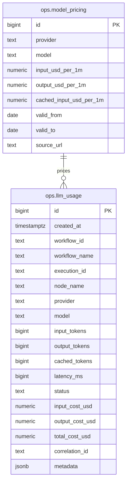

# NexusOps LLM Cost Tracking

## Overview

This document describes the LLM usage ledger, cost computation, budget guard, and how to instrument workflows to track LLM token usage and costs.

## Architecture

### Database Schema



### Cost Computation

- **Function**: `ops.fn_compute_llm_cost(provider, model, input_tokens, output_tokens, cached_tokens, created_at)`
- **Trigger**: `ops.trg_compute_llm_cost()` fires `BEFORE INSERT` on `ops.llm_usage`
- **Logic**: Finds pricing row valid at `created_at`, computes `(tokens / 1_000_000) * price_per_1m`
- **Cached tokens**: Billed at `cached_input_usd_per_1m` if available, else regular input rate
- **Missing pricing**: Costs = 0, `metadata.pricing_missing = true` (flagged, not crashed)

### Views

| View | Description |
|------|-------------|
| `ops.v_llm_cost_daily` | Daily cost per provider/model |
| `ops.v_llm_cost_by_workflow` | Aggregate cost per workflow |
| `ops.v_llm_cost_month_to_date` | MTD cost per provider/model |

## Workflows

### 1. `log_llm_usage` (callable sub-workflow)

**Purpose**: Normalize usage from any provider and insert into ledger.

**Call from any workflow after an LLM node:**

```json
{
  "provider": "openai",
  "model": "gpt-4o-mini",
  "response": { "usage": { "prompt_tokens": 1234, "completion_tokens": 567, "prompt_tokens_details": { "cached_tokens": 100 } } },
  "workflow_id": "={{ $workflow.id }}",
  "workflow_name": "={{ $workflow.name }}",
  "execution_id": "={{ $execution.id }}",
  "node_name": "OpenAI Node",
  "correlation_id": "optional-correlation-id"
}
```

**Provider normalization:**
- **OpenAI**: `response.usage.prompt_tokens`, `completion_tokens`, `prompt_tokens_details.cached_tokens`
- **Anthropic**: `response.usage.input_tokens`, `output_tokens`, `cache_read_input_tokens`
- **Gemini**: `response.usageMetadata.promptTokenCount`, `candidatesTokenCount`, `cachedContentTokenCount`
- **Missing usage**: Estimates from text length (~4 chars/token), sets `metadata.estimated=true`

### 2. `budget_guard` (scheduled hourly)

**Purpose**: Compare MTD spend vs `LLM_MONTHLY_BUDGET_USD`.

| Threshold | Action |
|-----------|--------|
| 80% | Telegram warning |
| 100% | Telegram critical alert |
| 100% + `BUDGET_ENFORCE=true` | Deactivate workflows tagged `llm-guarded` via n8n API |

**Environment variables:**
- `LLM_MONTHLY_BUDGET_USD` — monthly budget in USD (required)
- `BUDGET_ENFORCE` — `true`/`false` (default `false`)
- `BUDGET_WARNING_THRESHOLD` — default `0.8`
- `BUDGET_CRITICAL_THRESHOLD` — default `1.0`
- `N8N_API_KEY` — n8n API key for deactivation
- `N8N_PUBLIC_URL` — base URL for n8n API

### 3. `llm_cost_report` (weekly, Monday 09:00)

**Purpose**: Send Telegram summary with:
- Week total & MTD total
- Week-over-week change
- Daily breakdown (last 7 days)
- Top 5 workflows by cost
- MTD by model

## Instrumenting Your Workflows

### Pattern: Call `log_llm_usage` after every LLM node

```
[LLM Node] → [Execute Workflow: log_llm_usage]
```

**Execute Workflow node configuration:**
- **Workflow ID**: `log_llm_usage`
- **Mode**: `Run Once For All Items` (if LLM node outputs multiple items) or `Run Once For First Item`
- **Data to Pass**: See example below

### Example: After OpenAI Node

```json
{
  "provider": "openai",
  "model": "gpt-4o-mini",
  "response": "={{ $json }}",
  "workflow_id": "={{ $workflow.id }}",
  "workflow_name": "={{ $workflow.name }}",
  "execution_id": "={{ $execution.id }}",
  "node_name": "OpenAI",
  "correlation_id": "={{ $json.correlation_id || $execution.id }}"
}
```

### Example: After Anthropic Node

```json
{
  "provider": "anthropic",
  "model": "claude-3-5-sonnet-20241022",
  "response": "={{ $json }}",
  "workflow_id": "={{ $workflow.id }}",
  "workflow_name": "={{ $workflow.name }}",
  "execution_id": "={{ $execution.id }}",
  "node_name": "Anthropic",
  "correlation_id": "={{ $json.correlation_id || $execution.id }}"
}
```

### Screenshot Placeholder

```
┌─────────────────────────────────────────────────────────────┐
│  n8n Workflow Editor                                        │
│                                                             │
│  [OpenAI Node] ──▶ [Execute Workflow: log_llm_usage]       │
│       │                            │                        │
│       │  response.usage            │  provider: "openai"   │
│       │  {                         │  model: "gpt-4o-mini" │
│       │    prompt_tokens: 1234,    │  response: {{$json}}  │
│       │    completion_tokens: 567  │  ...                  │
│       │  }                         │                        │
│       ▼                            ▼                        │
│  Generates                    Logs to ops.llm_usage        │
│  text                          with computed costs         │
└─────────────────────────────────────────────────────────────┘
```

## Budget Guard Setup

1. **Set budget** in `.env`:
   ```bash
   LLM_MONTHLY_BUDGET_USD=100.00
   BUDGET_ENFORCE=true
   N8N_API_KEY=your-n8n-api-key
   N8N_PUBLIC_URL=https://n8n.yourdomain.com
   ```

2. **Tag workflows** to be guarded:
   - In n8n UI, edit workflow → Tags → Add `llm-guarded`
   - These will be auto-deactivated at 100% budget

3. **Enable workflow** `budget_guard` (activate in n8n)

## Example Queries

### Daily cost for current month
```sql
SELECT * FROM ops.v_llm_cost_daily
WHERE cost_date >= DATE_TRUNC('month', CURRENT_DATE)
ORDER BY cost_date DESC, total_cost_usd DESC;
```

### Top 10 workflows by cost
```sql
SELECT * FROM ops.v_llm_cost_by_workflow
ORDER BY total_cost_usd DESC
LIMIT 10;
```

### MTD spend vs budget
```sql
SELECT SUM(total_cost_usd) AS mtd_cost
FROM ops.v_llm_cost_month_to_date;
```

### Cost per execution (for debugging)
```sql
SELECT workflow_name, execution_id, node_name, provider, model,
       input_tokens, output_tokens, total_cost_usd
FROM ops.llm_usage
WHERE execution_id = 'exec-123'
ORDER BY created_at;
```

## Pricing Maintenance

**Critical**: The seed prices in `30-ops-llm.sql` are **EXAMPLE PLACEHOLDERS**. You MUST:

1. Check current prices:
   - OpenAI: https://openai.com/pricing
   - Anthropic: https://www.anthropic.com/pricing
   - Google: https://ai.google.dev/pricing

2. Update via SQL:
   ```sql
   -- Add new price (auto-expires old via valid_to)
   INSERT INTO ops.model_pricing (provider, model, input_usd_per_1m, output_usd_per_1m, valid_from, source_url)
   VALUES ('openai', 'gpt-4o', 2.50, 10.00, '2025-01-01', 'https://openai.com/pricing');
   ```

3. Or use the `log_llm_usage` workflow's metadata to detect missing pricing (`metadata.pricing_missing = true`)

## Testing Cost Computation

Run SQL tests in `tests/sql/test_llm_cost.sql`:

```sql
-- Test 1: Basic OpenAI cost
SELECT * FROM ops.fn_compute_llm_cost('openai', 'gpt-4o-mini', 1_000_000, 500_000, 0, '2024-08-01');
-- Expected: input=$0.15, output=$0.30, total=$0.45

-- Test 2: With cached tokens
SELECT * FROM ops.fn_compute_llm_cost('openai', 'gpt-4o-mini', 1_000_000, 500_000, 200_000, '2024-08-01');
-- Expected: input=$0.15 + cached=$0.015, output=$0.30, total=$0.465

-- Test 3: Missing pricing (flagged)
SELECT * FROM ops.fn_compute_llm_cost('openai', 'gpt-5', 1000, 1000, 0, '2024-08-01');
-- Expected: all costs 0, pricing_found=false

-- Test 4: Zero tokens
SELECT * FROM ops.fn_compute_llm_cost('openai', 'gpt-4o-mini', 0, 0, 0, '2024-08-01');
-- Expected: all costs 0

-- Test 5: Price change mid-month (valid_to)
-- Insert old price valid_to '2024-06-30', new price valid_from '2024-07-01'
-- Query with created_at '2024-06-15' → old price
-- Query with created_at '2024-07-15' → new price
```

## Files

| File | Purpose |
|------|---------|
| `infra/postgres/init/30-ops-llm.sql` | Schema, pricing, function, trigger, views |
| `workflows/ops/log_llm_usage.json` | Normalize & log usage |
| `workflows/ops/budget_guard.json` | Hourly budget check + enforcement |
| `workflows/ops/llm_cost_report.json` | Weekly Telegram report |
| `docs/llm-cost-tracking.md` | This document |
| `tests/sql/test_llm_cost.sql` | Unit-style SQL tests |

## Environment Variables

| Variable | Required | Description |
|----------|----------|-------------|
| `LLM_MONTHLY_BUDGET_USD` | For budget_guard | Monthly budget in USD |
| `BUDGET_ENFORCE` | Optional | `true` to deactivate guarded workflows |
| `BUDGET_WARNING_THRESHOLD` | Optional | Default `0.8` |
| `BUDGET_CRITICAL_THRESHOLD` | Optional | Default `1.0` |
| `N8N_API_KEY` | For enforcement | n8n API key |
| `N8N_PUBLIC_URL` | For enforcement/alerts | Public n8n base URL |
| `ALERT_TELEGRAM_BOT_TOKEN` | For alerts | Telegram bot token |
| `ALERT_TELEGRAM_CHAT_ID` | For alerts | Telegram chat ID |

## Optional: Dashboard (Compose Profile `dashboards`)

```yaml
# In compose.dashboards.yaml
services:
  metabase:
    image: metabase/metabase:v0.52
    environment:
      MB_DB_TYPE: postgres
      MB_DB_DBNAME: nexusops
      MB_DB_USER: ops_writer
      MB_DB_PASS: ${OPS_WRITER_PASSWORD}
      MB_DB_HOST: postgres
    profiles: ["dashboards"]
```

Run with: `COMPOSE_FILE=compose.yaml:compose.dashboards.yaml docker compose up -d`